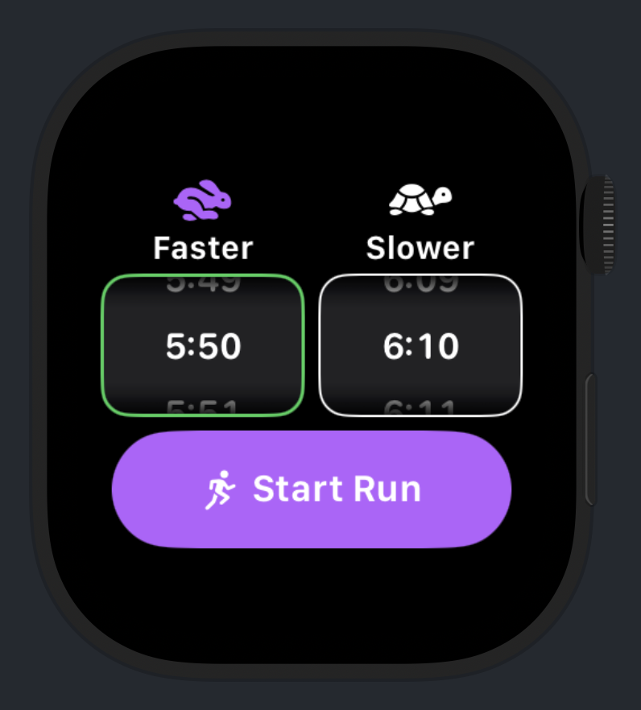
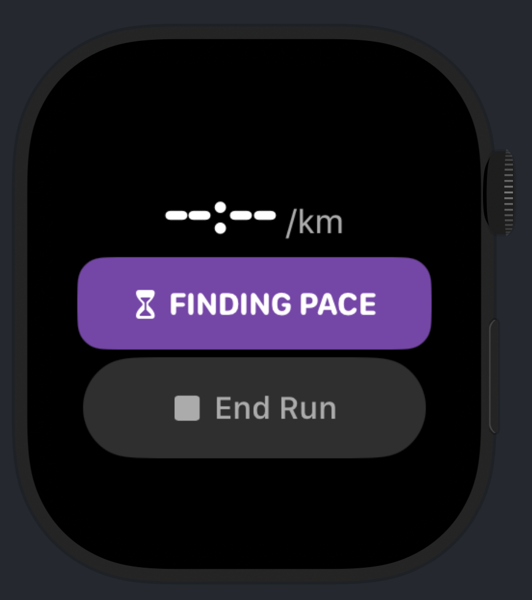
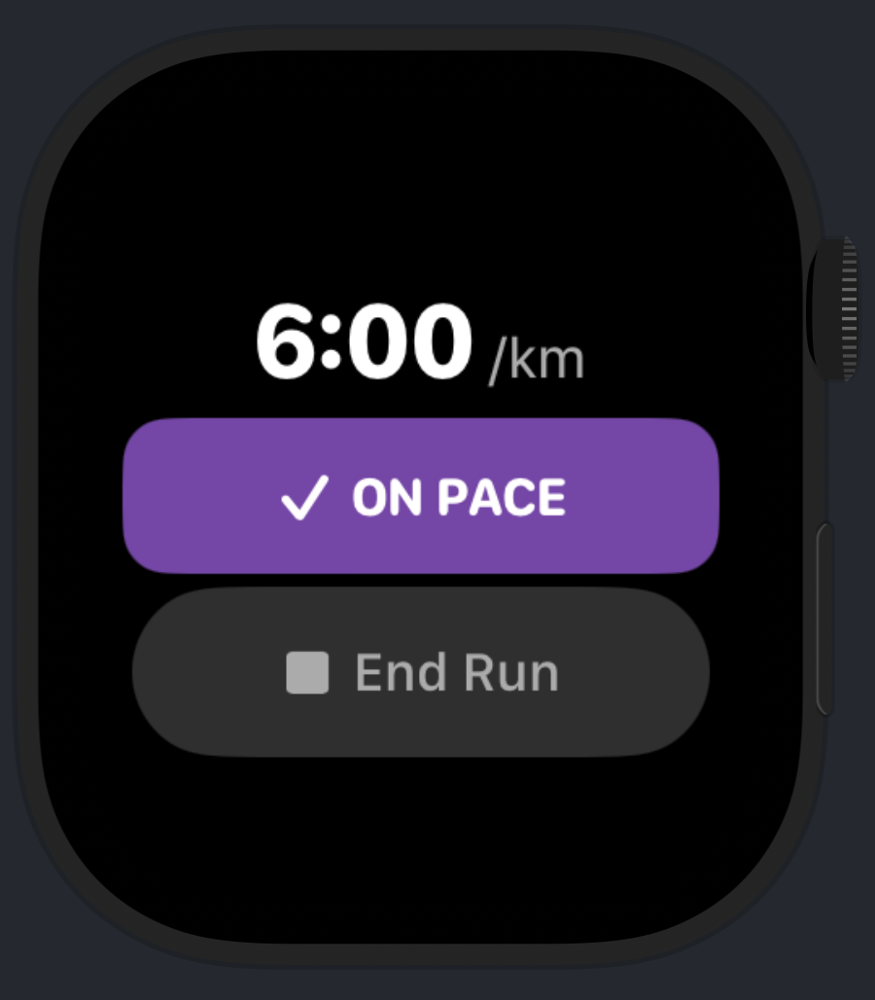
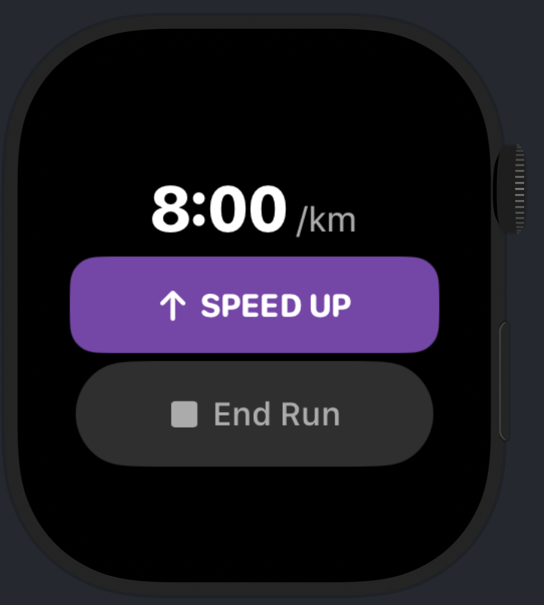
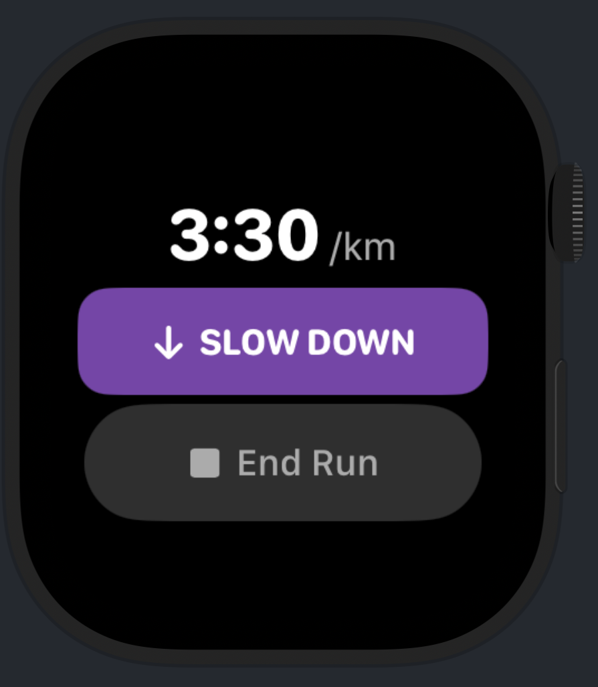

# PaceCoach

  

**An Apple Watch running coach with live pace and heart-rate zone guidance, plus an iPhone companion for Strava connection.**

## Screenshots

   
  Target Pace Setup

<table>
  <tr>
    <td align="center"> Finding Pace</td>
    <td align="center"> On Pace</td>
  </tr>
  <tr>
    <td align="center"> Speed Up</td>
    <td align="center"> Slow Down</td>
  </tr>
</table>

## Implemented

- **Target Pace:** Set a target pace range with the Digital Crown and receive live pace, voice, and haptic coaching.
- **Target Heart Rate Zone:** Train within HealthKit-based HRR zones with live heart-rate, voice, and haptic guidance.
- **HealthKit workouts:** Record outdoor runs to Apple Health/Fitness with duration, distance, average pace, heart rate, and GPS route data when available.
- **TCX export:** Generate TCX files from completed PaceCoach runs containing available GPS, distance, elevation, and heart-rate data.
- **Strava connection:** Connect Strava through the iPhone companion and securely provision the connection to the Watch. The Watch can independently maintain and refresh its Strava authentication.
- **Watch face widget:** Quickly launch PaceCoach from the Apple Watch face.

## Project structure

- `PaceCoach Watch App/` — running UI, coaching, HealthKit recording, TCX export, and Watch Strava token service.
- `PaceCoach iPhone App/` — companion UI, Strava OAuth, and initial Watch provisioning.
- `Shared/` — WatchConnectivity and provisioning payload shared by both apps.
- `PaceCoach Widget Extension/` — Watch face launcher widget.
- `Tests/` — regression checks for coaching, heart-rate zones, completed-run data, and TCX encoding.

## Development

Swift · SwiftUI · HealthKit · WatchConnectivity · Keychain · WidgetKit

Built with Xcode for watchOS 26.5+ and iOS 17.4+.
